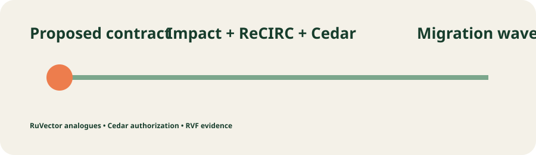
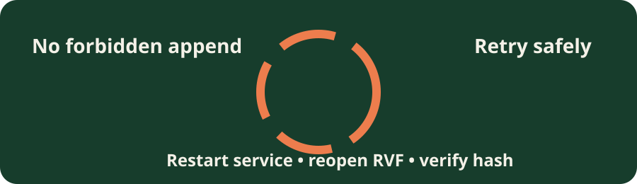

# Contract Current

   



Contract Current is an API-evolution control plane for platform teams that need to change a producer contract without surprising transitive consumers. It classifies a proposed schema change, maps consumer impact, retrieves analogous migrations with RuVector, computes input-adaptive ReCIRC risk, authorizes the change with AWS Cedar, emits ordered migration waves, and appends the exact decision to RVF for restart-safe audit.

## Run the prototype

Prerequisites: Linux, Rust 1.99, Node 20.20+, and Chromium for Playwright.

```bash
npm ci --prefix frontend
npx --prefix frontend playwright install chromium
./scripts/start.sh
```

Open [http://127.0.0.1:5173](http://127.0.0.1:5173). The API readiness endpoint is `http://127.0.0.1:18080/readyz`. Stop with `./scripts/stop.sh`; reset deterministic test state with `./scripts/reset.sh`.

## Product journeys

1. **Analyze and authorize:** submit an additive or standard OpenAPI change; the UI renders impacted consumers, ordered migration waves, calibrated risk, and an evidence hash returned by the Rust API.
2. **Deny and recover:** choose `breaking`; Cedar denies before any RVF append. Refresh proves the ledger count is unchanged, then a corrected `standard` retry succeeds.
3. **Restore after restart:** `./scripts/restart-journey.sh` creates a decision, terminates the real service, reopens RVF, and verifies the saved ID through the API.

## Composition

| Ingredient | Pinned version | Executed responsibility | Evidence |
|---|---:|---|---|
| RuVector Core | 2.4.0 | HNSW insert/search for analogous decisions | `cc-ruvector` test and primary path |
| RVF Runtime | 0.3.2 | append-only decision envelope, reopen/read | `cc-rvf`, restart journey |
| AWS Cedar | 4.14.0 | Cedar policy authorization before persistence | `cc-cedar`, denial journey |
| ReCIRC | arXiv:2609.38112 | input-adaptive local-risk rectification plus finite-sample risk control | `cc-calibration`, no-calibration ablation |

No single ingredient classifies an API diff, traverses consumer impact, recalls migration analogues, calibrates risk, authorizes persistence, and restores exact evidence after restart. The application-level composition lives in `cc-orchestrator`; the versioned Axum boundary lives in `cc-api`.

## Measured ablations

| Mode | End-to-end | Analogue recall | Restart retrieval | Policy denial |
|---|---:|---:|---:|---:|
| combined | yes | yes | yes | yes |
| Ruvnet only | yes | yes | yes | no |
| enterprise only | yes | no | no | yes |
| without RuVector | yes | no | yes | yes |
| without RVF | yes | yes | no | yes |
| without Cedar | yes | yes | yes | no |
| without ReCIRC calibration | no | yes | yes | yes |

These are deterministic prototype measurements emitted by `cc-evaluation`; they show that the combined capability depends on each major ingredient rather than merely listing dependencies.

## Verification

```bash
./scripts/verify-prototype.sh
```

The script runs structural checks, formatting, strict Clippy, locked Rust tests, Cargo deny, npm audit, frontend typecheck/lint/unit/build, contract drift, executed ingredient ablations, both Playwright viewports against the real API, and restart retrieval. Raw evidence is under `evidence/`.

## Workspace and design

The [architecture](docs/architecture.md) maps all 28 Rust crates to a bounded context, caller and acceptance evidence. See the [integration matrix](docs/integration-matrix.md), [prototype acceptance map](docs/prototype-acceptance.md), [25 ADRs](docs/adr/index.md), [12 DDD notes](docs/ddd/index.md), and [semantic review](evidence/semantic-review.md).



## Deployment and limits

Docker Compose supplies the same frontend/API topology. `deploy/cloudrun-service.yaml` and `deploy/rollback.sh` are configuration only: no cloud deployment or spend was performed. Local RVF is single-instance prototype persistence; production requires an authorized shared RuVector/RVF/Cloud SQL boundary and IAM-scoped secret delivery. Prototype auth uses a local bearer token from environment configuration, never browser service credentials. The Cargo policy carries one documented non-exploit maintenance exception inherited from RuVector; see `docs/security.md`.
